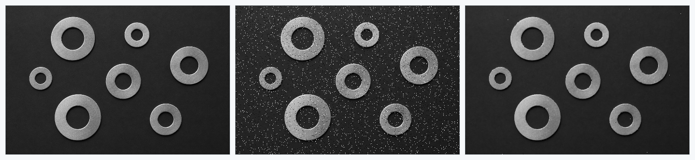
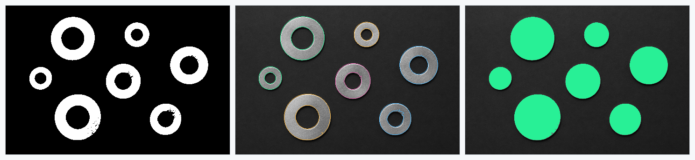
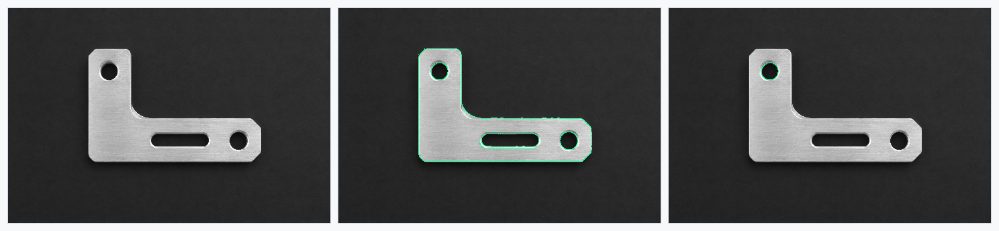
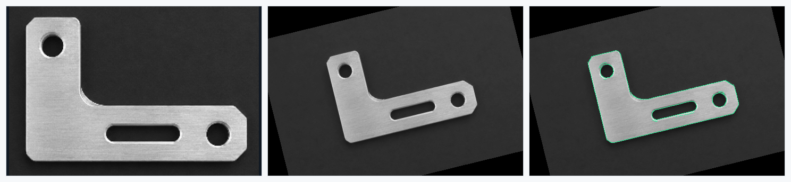
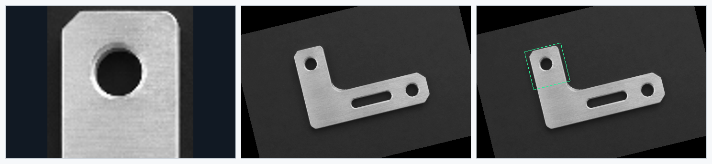

# mvkit

简体中文 | [English](docs/README.en.md)

## 项目简介

**mvkit** 是一款面向工业机器视觉的 C/C++ 基础算法库，涵盖图像处理、特征提取、匹配定位、相机标定、双目视觉及三维处理等核心功能。项目参考 **HALCON 的算子语义与数据对象组织方式** 实现独立开发，主要通过正向开发对齐HALCON算子的功能和性能，目前已实现 **277** 个与 HALCON 对应的常用视觉算子。

- **当前处于开发阶段，不保证 API/ABI 兼容。** 如使用建议 fork 后维护，或固定 commit/tag 使用。
- 本职工作主要负责测量算法，当前项目版本暂不开发或提供 **Measure/Metrology** 等测量相关接口。
- 大部分测试场景精度与 HALCON 基本一致，耗时约为 HALCON 的 **1–2 倍**之间。

推荐使用 **C++ 函数式和对象式接口**。函数式调用如 `mv::Threshold(image, &regions, ...)`，参数组织接近算子调用；对象式调用如 `image.Threshold(...)`，适合围绕图像、区域和模型组织业务。两种方式均由对象与元组自动管理资源，可按场景组合使用。C 接口主要供其他语言绑定及需要显式生命周期管理的应用使用。

初始版本：**0.1.0** · [发布说明](docs/version.md)。

## 效果展示

展示的图像处理、轮廓和匹配定位结果均为 mvkit 实际处理结果。

图像处理、Region、XLD、Shape/NCC 匹配分别提供 C++ 过程式和对象式两种演示，源码与运行命令见 [examples](examples/README.md)，原始输入图片见 [images](examples/images/)。




<p align="center"><strong>滤波</strong> · 原图 → 添加脉冲噪声 → 中值滤波</p>



<p align="center"><strong>区域与形态学</strong> · 阈值与开运算 → 连通域 → 填洞</p>



<p align="center"><strong>边缘提取与筛选</strong> · 原图 → Canny 亚像素轮廓 → 圆形轮廓筛选</p>



<p align="center"><strong>Shape 定位</strong> · 模板 → 搜索图像 → 匹配轮廓与位置</p>



<p align="center"><strong>NCC 定位</strong> · 模板 → 搜索图像 → 匹配位置</p>

## 架构介绍

```text
应用 / 其他语言绑定
        │
推荐：Public C++14 函数式 / 对象式接口，MvImage / MvRegion / MvTuple 等自动管理资源
        │
Public C11 接口：不透明对象、控制元组、状态与错误信息
        │
Private C++20：图像 / 区域 / XLD / 匹配 / 标定 / 三维算法
        │
runtime：内存资源、临时空间、CPU 特性检测、并行执行
```

生产共享库为 `mvkit` 和 `mvkitcpp`；内部算法静态库不作为 SDK 接口导出。公开头不暴露 Eigen、编解码库及 runtime 私有类型。

## 功能介绍

| 主要功能 | 当前能力 |
|---|---|
| 基础对象 | Image、Region、XLD、Tuple、Dict、控制句柄与错误信息；对象支持 0/1/N 个元素 |
| 图像读写 | BMP、JPEG、PNG、TIFF |
| 图像处理 | 滤波、阈值与自适应阈值、算术、颜色与通道操作、ROI、直方图、几何变换 |
| 区域与形态学 | 连通域、集合运算、筛选、填洞、膨胀/腐蚀、开闭运算、分水岭 |
| XLD 与亚像素边缘 | Canny/Sobel 边缘、轮廓生成/变换/分割/合并、直线/圆/椭圆拟合 |
| Shape 模板匹配 | 图像/XLD 建模、旋转与等比例缩放、多实例、多模板、亚像素定位及模型读写 |
| NCC 模板匹配 | 灰度相关、旋转、多实例、多模板、极性控制及模型读写 |
| 标定与几何 | 相机模型、相机标定、单应/PnP、畸变处理、投影、平面映射及手眼标定 |
| 双目与结构光 | 相机 setup、校正、SAD/Census/SGM 视差、深度/点云，Gray Code、相移与单条纹重建 |
| 三维处理 | 点云采样、法向、邻域、距离、拟合、配准及网格 |

接口存在不代表支持 HALCON 的全部参数组合。使用边界、对象规则和各功能说明见[文档入口](docs/README.md)。

## Runtime

**内存池**：默认启用内置池，持久对象与 scratch 临时空间分别管理，按块大小和对齐分档复用。线程本地分片配合共享分片减少分配竞争，支持跨线程释放；算子内 arena 优先使用 4 KiB 内联缓冲。缓存预算限制空闲块，超出预算的块归还系统，不限制正在使用的图像或点云大小。

**多线程**：主要参考 OpenCV 的 [`parallel_for_`](https://docs.opencv.org/4.x/d7/dff/tutorial_how_to_use_OpenCV_parallel_for_.html) 区间分块与任务执行方式进行改造，采用内置线程池和共享任务分块，复用 worker。默认串行，可通过构建选项启用并行；轻量任务和嵌套调用可回退串行。线程预算可用 `mv::SetSystem("thread_num", 4)` 设置，建议在首次并行计算前配置。

**CPU 特性派发**：运行时检测部署设备的 CPU 指令集和操作系统寄存器保存能力。默认自动模式下，已编译 AVX2 内核且 CPU/操作系统支持时，对具备对应实现且满足输入条件的计算自动选择 AVX2 分支；其余计算使用可用的 SSE2 或标量路径（无ARM开发环境，项目中暂无NEON指令代码）。后端配置和使用约束见 [runtime](docs/runtime.md)。

## 安装及使用

需要支持 C++20 的编译器来构建库；下游 C++ 应用可使用 C++14。CMake 3.20+；VS2026 需要支持该生成器的 CMake 4.2+。依赖优先复用系统开发库，缺失时从固定版本、固定 SHA-256 的上游归档构建。

Windows（VS2019/2022/2026，脚本自动优先选择较新版本）：

```powershell
./scripts/setup-windows.ps1
New-Item -ItemType Directory -Path build/demo-output -Force
./build/bin/Release/mvkit_demo_image_processing.exe ./examples/images ./build/demo-output
```

Ubuntu / WSL：

```sh
bash scripts/setup-ubuntu.sh --system
cmake --preset linux
cmake --build --preset linux --parallel
mkdir -p build/demo-output
./build/bin/mvkit_demo_image_processing ./examples/images ./build/demo-output
```

安装 SDK：

```sh
cmake --install build --config Release --prefix out/mvkit
```

下游 `CMakeLists.txt`：

```cmake
cmake_minimum_required(VERSION 3.20)
project(my_vision_app LANGUAGES CXX)
find_package(MVKit CONFIG REQUIRED)
add_executable(my_vision_app main.cpp)
target_link_libraries(my_vision_app PRIVATE mvkit::CXX)
target_compile_features(my_vision_app PRIVATE cxx_std_14)
```

`main.cpp`：

```cpp
#include <mvkit/cpp/mvkit.hpp>

int main() {
  mv::MvImage image, gray, filtered;
  mv::ReadImage(&image, "examples/images/washers.png");
  mv::Rgb1ToGray(image, &gray);
  mv::MedianImage(gray, &filtered, "circle", 1, "mirrored");
  mv::MvRegion regions;
  mv::Threshold(filtered, &regions, 105, 255);
  mv::WriteImage(filtered, "png", 0, "filtered.png");
}
```

配置下游时通过 `-DCMAKE_PREFIX_PATH=/absolute/path/to/out/mvkit` 指定安装前缀。Windows C++ 应用运行时需能找到 `mvkit.dll`、`mvkitcpp.dll` 及实际使用的编解码运行库。完整配置与离线构建见[构建说明](docs/build.md)。

## 项目开发环境

当前主要开发机：Intel Core i5-13600K（14 核/20 线程）、约 64 GiB 内存、Windows 11 x64、Visual Studio 2026 / MSVC 19.51。Linux 在 WSL2 的 Ubuntu 24.04.4 LTS 中构建，使用 GCC 13.3、CMake 3.28.3 和 Ninja 1.11.1。环境信息说明见[开发与验证环境](docs/platform.md)。

## 补充说明

- 本仓库是用于公开发行的源码子集，不包含开发阶段的测试、基准工具和旧 C/C++ 合成数据示例。
- 模型与序列化数据使用 mvkit 自有格式，不兼容 HALCON 二进制模型格式。
- HALCON 仅用于独立开发环境中的公开接口参考与正常对照；不作为本项目依赖，不附带其图像、模型或运行库。
- 自有代码与合成素材采用 [Apache-2.0](LICENSE)；第三方组件继续保留其原有许可。见 [NOTICE](NOTICE) 和[第三方组件与许可](#第三方组件与许可)。

## 第三方组件与许可

MVKit 自有代码采用 [Apache License 2.0](LICENSE)。该许可不替代第三方组件、图片、模型或其他素材的原有许可；各组件源文件中的版权及许可声明继续有效。项目通知见 [NOTICE](NOTICE)。

以下版本是随仓库提供或源码回退固定使用的版本；系统库的实际版本和传递依赖以本次构建及最终发行包为准。固定下载地址与 SHA-256 见 [Dependencies.cmake](cmake/Dependencies.cmake)。

| 组件 | 版本及使用范围 | 原始许可与来源 |
|---|---|---|
| Eigen | 3.4.0；可选私有数值后端，头文件随 Git 提供，来自 CasADi 的 Eigen 树；生产使用 Eigen/Dense | MPL-2.0 及逐文件声明；[来源记录](3rdparty/eigen/README.MVKit)、[许可原文](3rdparty/eigen/COPYING.MPL2)、[上游](https://eigen.tuxfamily.org/) |
| libjpeg-turbo | 3.1.4.1；JPEG 编解码的源码回退 | IJG、BSD、zlib 相关许可，适用范围以原始 LICENSE.md、README.ijg 及逐文件声明为准；[上游许可](https://github.com/libjpeg-turbo/libjpeg-turbo/blob/3.1.4.1/LICENSE.md) |
| libpng | 1.6.58；PNG 编解码的源码回退 | PNG Reference Library License 及历史声明；[上游许可](https://github.com/pnggroup/libpng/blob/v1.6.58/LICENSE) |
| LibTIFF | 4.7.2；TIFF 编解码的源码回退 | 上游宽松许可及逐文件声明；[上游许可](https://gitlab.com/libtiff/libtiff/-/blob/v4.7.2/LICENSE.md) |
| zlib | 1.3.2；编解码传递依赖的源码回退 | zlib License；[上游许可](https://github.com/madler/zlib/blob/v1.3.2/LICENSE) |

使用 libjpeg-turbo 时保留以下通知：

> This software is based in part on the work of the Independent JPEG Group.
